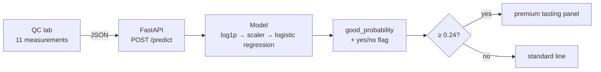
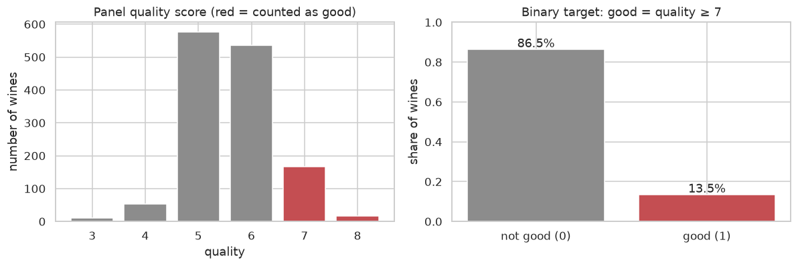
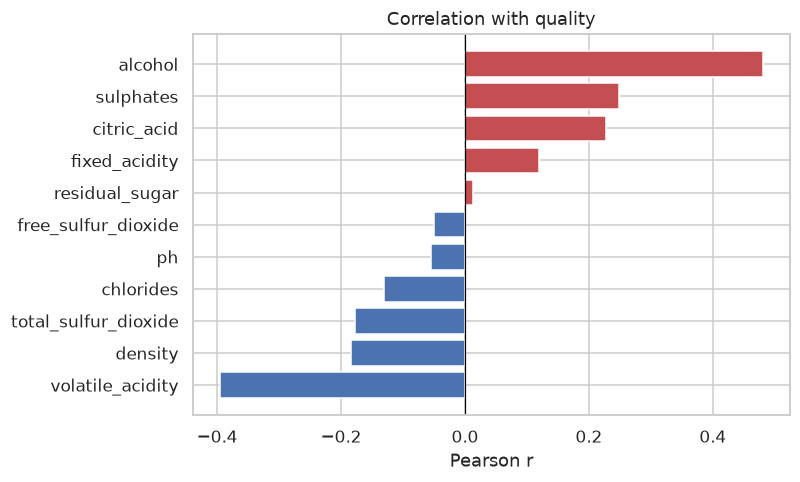
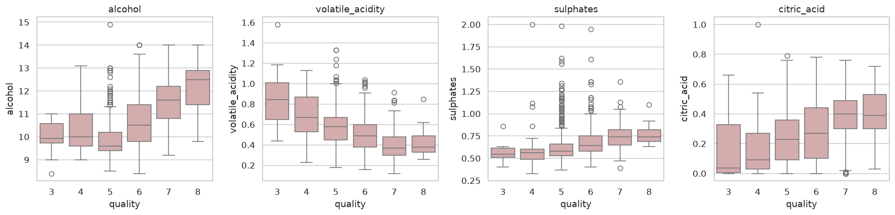
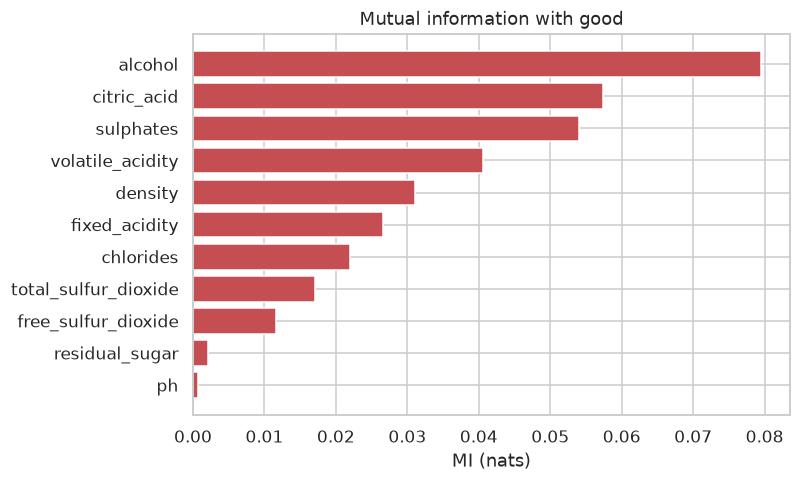
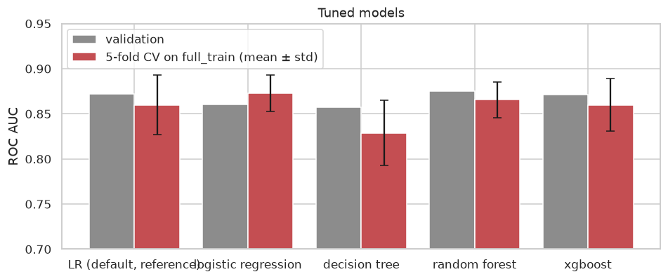
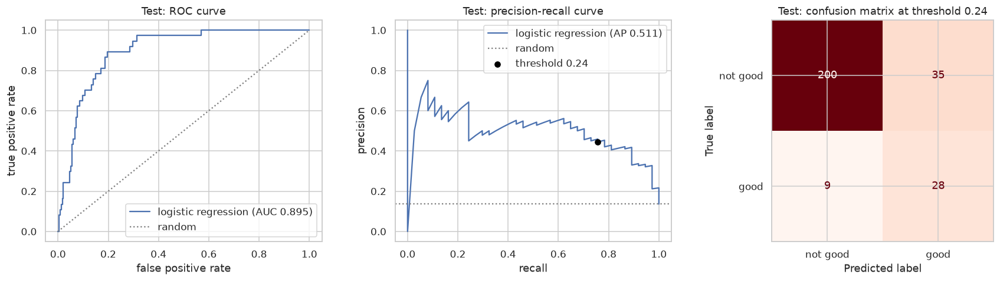
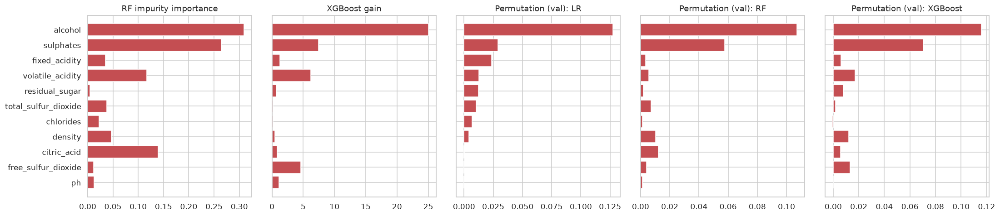
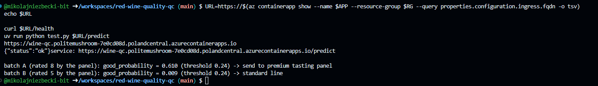
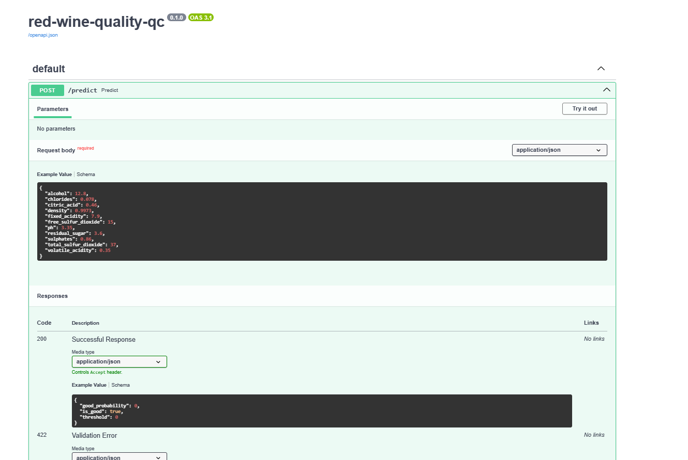

# Red Wine Quality QC

Predict, from a batch's lab analysis, the probability that a tasting panel will rate a red *Vinho Verde* wine as
**good** (quality ≥ 7). The model is served as a REST API, packaged with Docker and deployed on Azure Container Apps.

*Midterm project for [ML Zoomcamp 2026](https://github.com/DataTalksClub/machine-learning-zoomcamp) (DataTalks.Club).*



**Contents:**
[Problem](#problem-description) ·
[Dataset](#dataset) ·
[EDA](#eda-highlights) ·
[Modeling](#modeling) ·
[Project structure](#project-structure) ·
[Run locally](#how-to-run-locally) ·
[Docker](#docker) ·
[Cloud](#cloud-deployment-azure-container-apps) ·
[API](#api-reference) ·
[Limitations](#limitations-and-next-steps)

---

## Problem description

**Context.** Before bottling, a winery's lab measures the physicochemical profile of every batch: acidity, sugar,
sulfur dioxide, sulphates, alcohol and so on. The final quality grade, however, comes from a **sensory panel** of
trained tasters, which is slow and expensive and can only taste a limited number of batches.

**Problem.** Given the 11 lab values of a red Vinho Verde batch, estimate the **probability that the panel will rate
it good** (quality ≥ 7 on a 0–10 scale). This is a binary classification problem.

**How the model is used.** A QC technician sends the lab values to the API and gets back `good_probability` and a
yes/no flag (`is_good`). The winery uses it to:

1. **prioritise** which batches go to the full tasting panel and the premium line;
2. **flag likely-mediocre batches early**, while blending or other adjustments are still possible.

The panel still tastes every flagged batch: the model decides *which batches to look at first*, not the final grade.

**Who it is *not* for.** Consumers in a shop. They don't know a wine's volatile acidity or sulphate content.

**Metric.** Only 13.5% of the wines are good, so accuracy is misleading: a "model" that always answers *not good* is
already 86.5% accurate while finding none of the good wines. The project therefore uses:

- **ROC AUC** as the primary metric (threshold-independent);
- **PR AUC** (average precision) as the secondary metric, because it focuses on the rare positive class;
- **precision, recall and F1** at the chosen decision threshold.

## Dataset

**Source.** UCI Machine Learning Repository, [*Wine Quality*](https://archive.ics.uci.edu/dataset/186/wine+quality)
(red wines only), licensed under [CC BY 4.0](https://creativecommons.org/licenses/by/4.0/).

> P. Cortez, A. Cerdeira, F. Almeida, T. Matos and J. Reis. *Modeling wine preferences by data mining from
> physicochemical properties.* Decision Support Systems 47(4):547–553, 2009.

The file is committed as [`data/winequality-red.csv`](data/winequality-red.csv) (1,599 rows, semicolon-separated,
84 KB). To download it again from UCI:

```bash
curl -o data/winequality-red.csv \
  https://archive.ics.uci.edu/ml/machine-learning-databases/wine-quality/winequality-red.csv
```

The code detects the separator automatically, so a comma-separated copy (as found on Kaggle) works too.

**Features.** All numeric, no missing values. Column names are converted to snake_case.

| Feature | Unit | Range in data |
|---------|------|---------------|
| `fixed_acidity` | g(tartaric acid)/dm³ | 4.6 – 15.9 |
| `volatile_acidity` | g(acetic acid)/dm³ | 0.12 – 1.58 |
| `citric_acid` | g/dm³ | 0 – 1.0 |
| `residual_sugar` | g/dm³ | 0.9 – 15.5 |
| `chlorides` | g(sodium chloride)/dm³ | 0.012 – 0.611 |
| `free_sulfur_dioxide` | mg/dm³ | 1 – 72 |
| `total_sulfur_dioxide` | mg/dm³ | 6 – 289 |
| `density` | g/cm³ | 0.990 – 1.004 |
| `ph` | – | 2.74 – 4.01 |
| `sulphates` | g(potassium sulphate)/dm³ | 0.33 – 2.0 |
| `alcohol` | % vol. | 8.4 – 14.9 |

**Target.** `good = 1` if the panel's `quality` score is **≥ 7**, otherwise 0. `quality` itself is used only for EDA
and never as a feature.

**Duplicates and leakage.** The file contains **240 exact duplicate rows (15%)**. With duplicates, an identical wine
can land in both the training and the validation part of a split; on average 23% of validation rows had a copy in
training. That inflated the cross-validated ROC AUC of a default random forest from **0.872 to 0.917**. Duplicates are
therefore removed **before** any splitting, leaving **1,359 unique wines, 184 of them good (13.5%)**.

## EDA highlights

The full analysis is in [`notebook.ipynb`](notebook.ipynb) §3: ranges of values, missing values, target analysis,
distributions, correlation, mutual information and outliers.

| | |
|---|---|
|  | **Imbalanced target.** Most wines score 5 or 6; only 13.5% reach 7 or 8. Every split is stratified, and accuracy is not used as a metric. |
|  | **Correlation with quality.** Alcohol (+0.48) and volatile acidity (−0.40) are the strongest linear signals, followed by sulphates (+0.25) and citric acid (+0.23). |
|  | **Trends across the whole scale.** Median alcohol, sulphates and citric acid rise with quality; volatile acidity (a vinegar-like fault) falls. The boxes overlap a lot, so no single feature is enough. |
|  | **Mutual information** (which also catches non-linear relations) agrees on the same top four. Residual sugar and pH carry almost no information about `good`. |

Other findings:

- Several features are strongly right-skewed (chlorides, residual sugar, sulphates, SO₂), which is why the linear model
  uses a `log1p` transform.
- There are collinear groups (fixed acidity–citric acid–density–pH, free vs total SO₂, density–alcohol).
- Outliers were **kept**: they are physically plausible, removing them would drop a quarter of the data, and rows with
  outliers are *more* often good (17% vs 13.5%).

## Modeling

**Validation.** Stratified 60/20/20 train/validation/test split (`random_state=1`): 815 / 272 / 272 wines, each with
13.5–13.6% good. The validation set has only 37 good wines, so the tuned models were also compared with **5-fold
stratified cross-validation** on full_train (train + validation, 1,087 wines). The test set was used **once**, at the end.

**Models and tuning** (notebook §5–§9):

| Model | Tuned parameters (ranges) | Chosen |
|-------|---------------------------|--------|
| Baseline: always "not good" | – | – |
| Logistic regression | `C` ∈ {0.001 … 100}, `class_weight` ∈ {None, balanced}, `log1p` on/off | `log1p` + scaling, `C=0.1`, no class weights |
| Decision tree | `max_depth` ∈ {1 … 20, None}, `min_samples_leaf` ∈ {1 … 100} | `max_depth=5`, `min_samples_leaf=50` |
| Random forest | `max_depth` ∈ {5, 10, 15}, `min_samples_leaf` ∈ {1 … 50}, `n_estimators` 10–200, class weights | 200 trees, `max_depth=10`, `min_samples_leaf=50`, balanced |
| XGBoost | `eta` ∈ {0.3 … 0.01}, `max_depth` ∈ {3, 4, 6, 10}, `min_child_weight` ∈ {1, 10, 30}, `scale_pos_weight` | `eta=0.3`, `max_depth=6`, `min_child_weight=30`, 150 rounds |

**Comparison** (notebook §10):

| Model | Val ROC AUC | Val PR AUC | CV ROC AUC (mean ± std) | CV PR AUC (mean ± std) |
|-------|------------:|-----------:|------------------------:|-----------------------:|
| Always "not good" | 0.500 | 0.136 | – | – |
| Logistic regression, default | 0.872 | 0.469 | 0.860 ± 0.033 | 0.502 ± 0.060 |
| **Logistic regression, tuned** | 0.861 | 0.459 | **0.873 ± 0.020** | 0.543 ± 0.042 |
| Decision tree | 0.858 | 0.471 | 0.829 ± 0.036 | 0.449 ± 0.055 |
| Random forest | 0.875 | 0.552 | 0.866 ± 0.020 | 0.556 ± 0.078 |
| XGBoost | 0.871 | 0.533 | 0.860 ± 0.029 | 0.544 ± 0.092 |



**Choice: logistic regression.** Logistic regression, random forest and XGBoost are **tied within noise**: on the
single validation split the random forest leads, while in cross-validation the order flips. Following the rule
"if scores are within noise, prefer the simpler model", logistic regression wins. It has the best cross-validated
ROC AUC, it is the simplest model (11 coefficients plus an intercept), its outputs are **calibrated probabilities**
(important, because the API returns `good_probability`), and it is easy to explain to a QC lab.

Final pipeline: `DictVectorizer → log1p → StandardScaler → LogisticRegression(C=0.1)`

**Threshold** (notebook §11). The yes/no flag uses **0.24**, the F1-optimal threshold on validation. It sits well below
0.5 because good wines are rare. It leans towards recall: a false "good" costs one extra tasting, while a missed good
batch costs premium revenue. The threshold is stored in `model.bin`, so it can be changed without retraining.

**Test results** (final model trained on full_train, evaluated once on test, notebook §12):

| ROC AUC | PR AUC | Precision | Recall | F1 |
|--------:|-------:|----------:|-------:|---:|
| 0.895 | 0.511 | 0.44 | 0.76 | 0.56 |

At threshold 0.24 the model finds **28 of the 37 good wines** in the test set, and 44% of the batches it flags are
actually good (vs 13.6% when picking batches at random). Test AUC is slightly above the cross-validation mean
(0.873), within the ±0.02–0.03 spread expected with 37 positives; there is no sign of overfitting.



**Top features.** Every importance method (random-forest impurity, XGBoost gain, permutation importance for all three
models) ranks **alcohol #1 and sulphates #2**, matching the EDA. In the logistic regression, alcohol (+0.72) and
sulphates (+0.57) raise the odds of "good"; volatile acidity (−0.58), density (−0.43) and total SO₂ (−0.36) lower them.



## Project structure

```
red-wine-quality-qc/
├── README.md
├── SPEC.md                 # project plan and requirements
├── data/
│   └── winequality-red.csv # dataset (UCI, CC BY 4.0)
├── notebook.ipynb          # data preparation, EDA, model selection (outputs saved)
├── train.py                # trains the final model and saves model.bin
├── model.bin               # trained pipeline + threshold (committed, so Docker builds without retraining)
├── predict.py              # FastAPI service
├── test.py                 # sends two example wines to a running service
├── tests/
│   └── test_api.py         # pytest tests for the API
├── pyproject.toml          # dependencies (serving) + dev group (notebook, tests)
├── uv.lock                 # exact locked versions
├── .python-version         # Python 3.12
├── Dockerfile
├── .dockerignore
├── deploy/
│   └── azure.md            # step-by-step Azure Container Apps deployment
├── images/                 # plots used in this README + deployment screenshots
```

## How to run locally

Requirements: Python 3.12 and [uv](https://docs.astral.sh/uv/). Dependencies are declared in `pyproject.toml` and
pinned in `uv.lock`. The main dependencies are only what the API needs; the `dev` group adds pandas, Jupyter,
XGBoost, plotting and testing libraries.

```bash
git clone https://github.com/mikolajniezbecki-bit/red-wine-quality-qc.git
cd red-wine-quality-qc

pip install uv           # if you don't have uv yet
uv sync                  # creates .venv and installs all dependencies (including the dev group)
source .venv/bin/activate   # optional: activate the virtual env (otherwise prefix commands with `uv run`)
```

**Train the model** (takes a few seconds and overwrites `model.bin`):

```bash
uv run python train.py
```

Expected output ends with `test ROC AUC: 0.8948` and `test PR AUC: 0.5109`, matching the notebook.

**Notebook:**

```bash
uv run jupyter notebook notebook.ipynb
# or re-execute it top to bottom without opening it:
uv run jupyter nbconvert --to notebook --execute --inplace notebook.ipynb
```

**Start the API** and send the two example wines from a second terminal:

```bash
uv run uvicorn predict:app --host 0.0.0.0 --port 9696
```

```bash
uv run python test.py
```

```
service: http://localhost:9696/predict

batch A (rated 8 by the panel): good_probability = 0.610 (threshold 0.24) -> send to premium tasting panel
batch B (rated 5 by the panel): good_probability = 0.009 (threshold 0.24) -> standard line
```

Interactive API docs: <http://localhost:9696/docs>.

**Run the tests:**

```bash
uv run pytest
```

## Docker

The [`Dockerfile`](Dockerfile) uses `python:3.12-slim-bookworm`, installs the locked serving dependencies with
`uv sync --locked --no-dev` (so the container has the same scikit-learn version that trained `model.bin`), and copies
only `predict.py` and `model.bin`.

```bash
docker build -t red-wine-quality-qc .
docker run -it --rm -p 9696:9696 red-wine-quality-qc
```

Then, in another terminal:

```bash
uv run python test.py
```

## Cloud deployment (Azure Container Apps)

The same Docker image runs on **Azure Container Apps** (region Poland Central), with a public HTTPS endpoint:

**<https://wine-qc.politemushroom-7e0cd08d.polandcentral.azurecontainerapps.io/docs>**

> The app may be shut down after the course grading period to avoid costs; the screenshots below show it working.
> It scales to zero when idle, so the first request after a pause can take a few seconds.

Test it against the cloud URL:

```bash
uv run python test.py https://wine-qc.politemushroom-7e0cd08d.polandcentral.azurecontainerapps.io/predict
```





All deployment commands (container registry, image push, `az containerapp up`, logs, updates and teardown) are in
[`deploy/azure.md`](deploy/azure.md).

## API reference

### `POST /predict`

Request body: the 11 lab measurements of one batch.

```json
{
  "fixed_acidity": 7.9,
  "volatile_acidity": 0.35,
  "citric_acid": 0.46,
  "residual_sugar": 3.6,
  "chlorides": 0.078,
  "free_sulfur_dioxide": 15.0,
  "total_sulfur_dioxide": 37.0,
  "density": 0.9973,
  "ph": 3.35,
  "sulphates": 0.86,
  "alcohol": 12.8
}
```

Response:

```json
{
  "good_probability": 0.610,
  "is_good": true,
  "threshold": 0.24
}
```

- `good_probability`: estimated probability that the panel rates the batch ≥ 7.
- `is_good`: `good_probability >= threshold`.
- `threshold`: the decision threshold stored in the model file.

**Input validation.** Every field is required. Values outside these plausible physical ranges (a bit wider than the
dataset) are rejected with **HTTP 422**, since they are most likely typos:

| Field | Allowed range | Field | Allowed range |
|-------|---------------|-------|---------------|
| `fixed_acidity` | 3 – 20 | `free_sulfur_dioxide` | 0 – 150 |
| `volatile_acidity` | 0 – 2.5 | `total_sulfur_dioxide` | 0 – 350 |
| `citric_acid` | 0 – 1.5 | `density` | 0.98 – 1.01 |
| `residual_sugar` | 0 – 30 | `ph` | 2.5 – 4.5 |
| `chlorides` | 0 – 1 | `sulphates` | 0 – 3 |
| | | `alcohol` | 7 – 16 |

**curl example:**

```bash
curl -X POST http://localhost:9696/predict \
  -H "Content-Type: application/json" \
  -d '{"fixed_acidity": 7.4, "volatile_acidity": 0.70, "citric_acid": 0.0, "residual_sugar": 1.9,
       "chlorides": 0.076, "free_sulfur_dioxide": 11.0, "total_sulfur_dioxide": 34.0,
       "density": 0.9978, "ph": 3.51, "sulphates": 0.56, "alcohol": 9.4}'
```

### `GET /health`

Returns `{"status": "ok"}`.

## Limitations and next steps

**Limitations:**

- Only Portuguese red *Vinho Verde*, from around 2009; the model should not be used for other wines without retraining.
- No grape variety, producer, vintage or price information.
- The target is a subjective panel score.
- Very few wines at the extremes (10 rated 3, 17 rated 8 after de-duplication).
- The test set has only 37 good wines, so test metrics are uncertain by roughly ±0.03.

**Next steps:**

- Add the white wines from the same dataset, with a `wine_type` feature.
- Model the full quality score (regression or ordinal classification) instead of a yes/no target.
- Monitor live predictions against the panel's actual grades and retrain when they drift.

## Acknowledgements

- [ML Zoomcamp](https://github.com/DataTalksClub/machine-learning-zoomcamp) by DataTalks.Club and Alexey Grigorev.
- Dataset: P. Cortez, A. Cerdeira, F. Almeida, T. Matos and J. Reis, *Modeling wine preferences by data mining from
  physicochemical properties*, Decision Support Systems 47(4):547–553, 2009, via the
  [UCI Machine Learning Repository](https://archive.ics.uci.edu/dataset/186/wine+quality) (CC BY 4.0).
